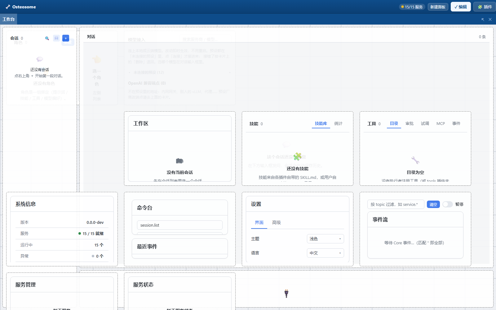
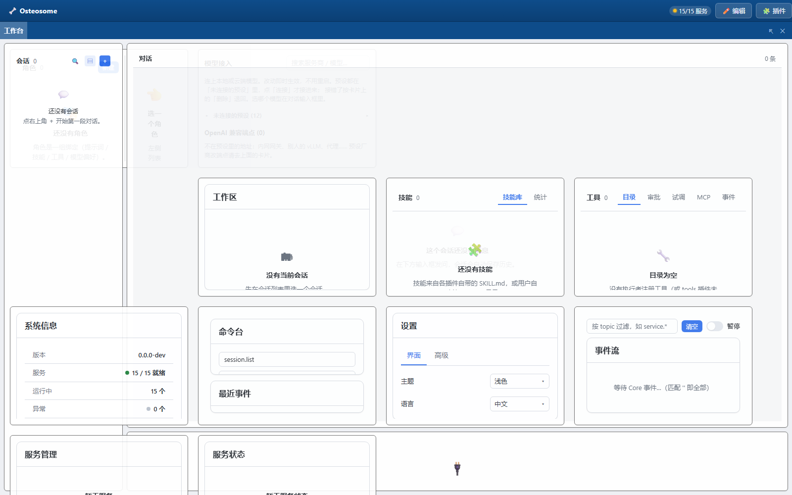
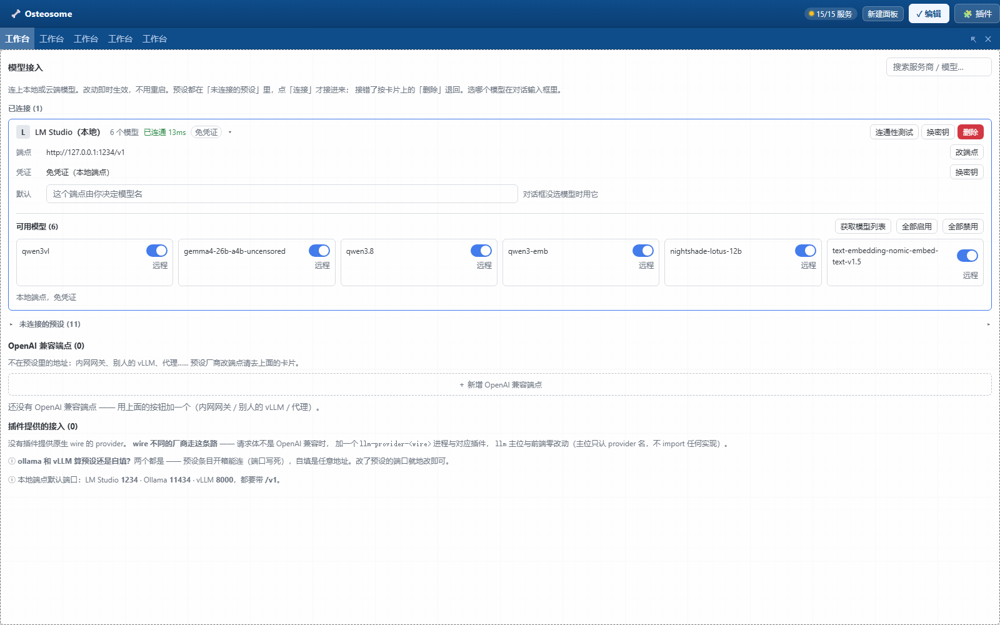
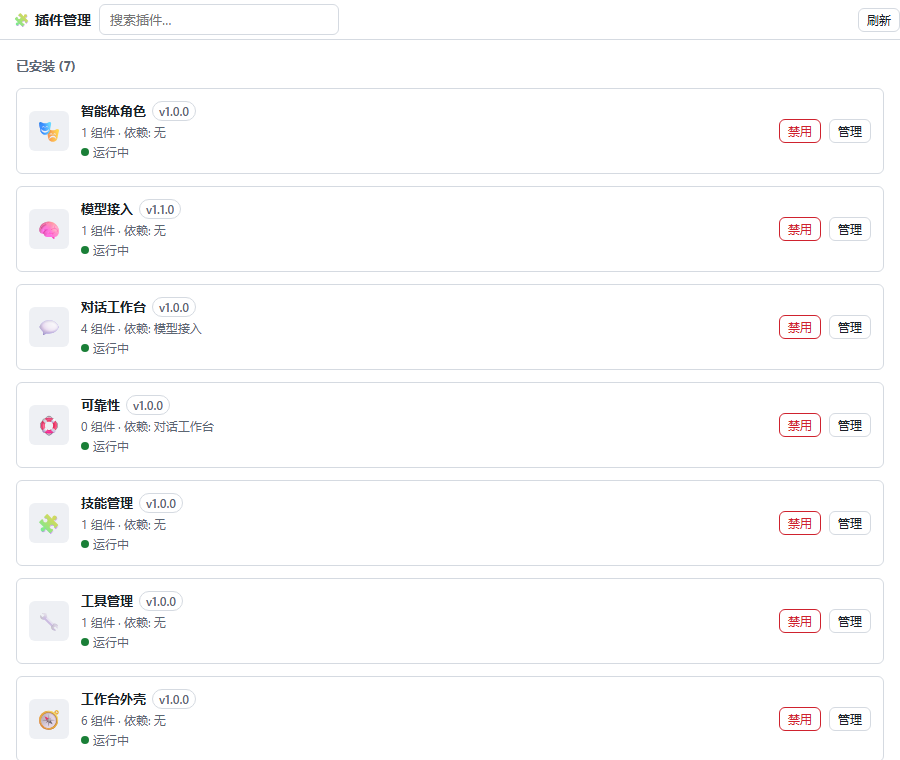
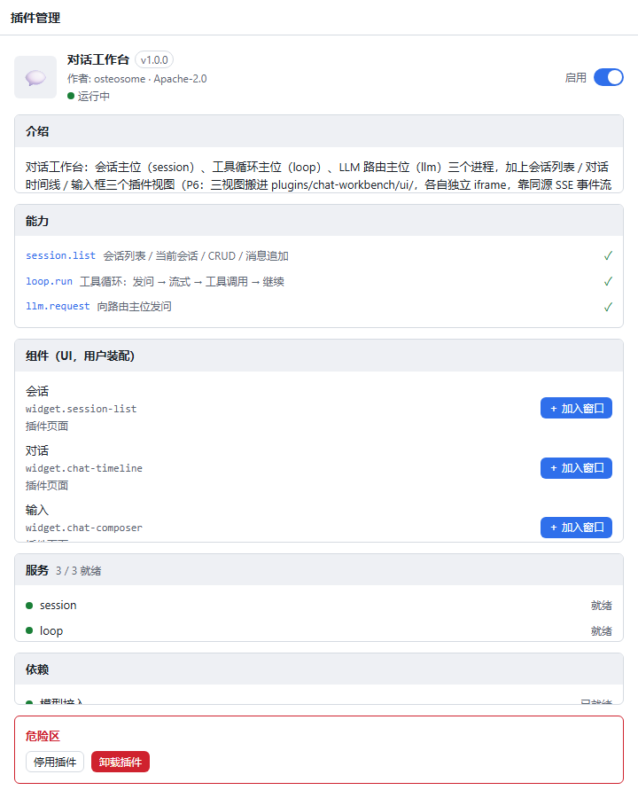
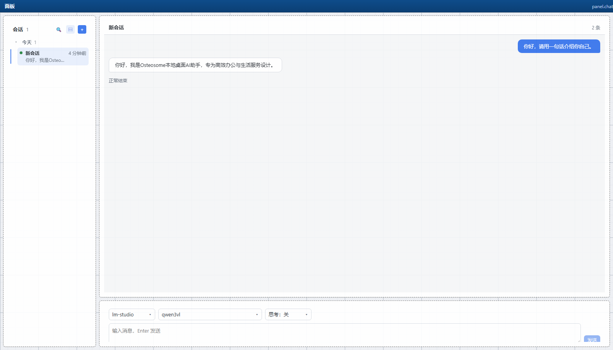

# Osteosome 桌面 AI 智能体工作台 —— 软件说明书

> 版本：V1.0　｜　编制日期：2026 年 10 月 10 日
> 本说明书中标注为【待填写】的内容为著作权登记人信息，请登记人补全后再行提交。

---

## 1 引言

### 1.1 编写目的

本说明书用于说明 Osteosome 桌面 AI 智能体工作台的运行环境、安装与启动方法、主要界面构成与各功能
模块的操作方式，供软件著作权登记、软件使用培训与日常使用参考。

### 1.2 软件概述

Osteosome 是一款**运行在用户个人计算机本地的桌面 AI 智能体工作台**。它以本地运行的微内核
（Core）为中心，把「模型接入」「对话」「角色」「技能」「工具」「插件管理」等全部能力都做成可装可卸
的插件，用户在一个窗口内即可完成「接入模型 → 与智能体对话 → 让智能体调用工具做事」的完整流程，
且全部会话、配置与凭证都保存在用户本机，不上传第三方服务器。

软件由两部分组成：

- **桌面客户端**：Tauri 2 外壳 + Vue 3 工作台界面，负责界面呈现与用户交互；
- **本地后台**：Core 微内核与各插件提供的后台服务进程，负责插件装配、事件转发、会话存储、模型
  调用与工具执行。

软件启动后无需登录，全部功能在本地离线可用；仅在调用云端模型服务商时才需要外网连接，若接入的是
本机推理服务（如 LM Studio）则可全程离线运行。

### 1.3 术语与缩略语

| 术语 | 含义 |
|---|---|
| Core | 微内核，负责发现插件、拉起服务、转发事件、托管静态资源 |
| 插件（Plugin） | 一个功能单元，以目录形式存在，内含清单文件 `plugin.json`、后台服务与界面组件 |
| 服务（Service） | 插件提供的后台进程，随应用启动，通过标准输入输出与内核通信 |
| 面板（Panel） | 工作台的容器区域，可停靠、拖拽、分屏，内部装配一个或多个组件 |
| 组件（Widget） | 装配进面板的最小界面单元，由插件提供，运行在独立 iframe 中 |
| 会话（Session） | 一次连续的对话，含标题、创建时间、更新时间与消息列表 |
| 循环（Loop） | 智能体的执行引擎，负责把用户输入送去模型、处理流式回复与工具调用 |
| 工具（Tool） | 智能体可以调用的动作，如读取文件、执行命令、抓取网页 |
| 技能（Skill） | 一段可被智能体加载使用的说明与资源包 |
| 角色（Character） | 智能体的人格设定，包含人格、用户档案、记忆、默认模型与工具 |
| 事件（Event） | 由内核或服务广播出来的通知，如「服务已就绪」「消息已追加」 |
| 命令（Command） | 由界面发往服务的一次请求，如「列出会话」「发送模型请求」 |
| SSE | Server-Sent Events，服务端推送事件流，本软件用它向界面实时推送状态 |

---

## 2 运行环境

### 2.1 硬件环境

| 项目 | 最低配置 | 推荐配置 |
|---|---|---|
| 处理器 | 双核 2.0 GHz | 四核 2.5 GHz 及以上 |
| 内存 | 4 GB | 8 GB 及以上 |
| 硬盘可用空间 | 500 MB（不含本地模型文件） | 2 GB 及以上 |
| 显示器分辨率 | 1280 × 800 | 1600 × 900 及以上 |
| 网络 | 接入云端模型服务商时需要 | 使用本机推理服务时可离线运行 |

> 若在本机运行大模型推理服务（如 LM Studio、Ollama、vLLM），需按所选模型另行准备内存与显存。

### 2.2 软件环境

**运行（用户使用）所需**

| 项目 | 要求 |
|---|---|
| 操作系统 | Windows 10 / 11（64 位）；软件基于 Tauri 2，亦可构建为 macOS / Linux 版本 |
| 运行时 | Node.js 22.13.0 及以上（实测 v24.14.0）。**使用打包后的桌面安装包时可省略**，源码方式启动时必须 |
| 浏览器内核 | 系统内置的 WebView2（Windows 11 已预装）；以浏览器方式访问时需 Chrome / Edge 等现代浏览器 |
| 包管理器 | pnpm 11 及以上（仅源码方式安装依赖时需要；工程以 `packageManager` 固定为 pnpm 11.1.2） |
| 模型服务 | 本机推理服务或任一 OpenAI 兼容协议的云端服务商，由用户在软件内配置 |

**开发与构建所需（可选）**

| 项目 | 版本 |
|---|---|
| Node.js | v24.14.0（工程要求 ≥ 22.13.0） |
| pnpm | 11.1.2 |
| TypeScript | 5.9.3 |
| Vite | 7.3.6 |
| Vitest | 3.2.7 |
| Rust / Cargo | rustc 1.98.1（构建桌面安装包时需要，另需 Visual Studio 2022 C++ 生成工具） |

主要第三方组件及版本：Vue 3.5.43、vue-router 5.3.1、pinia 4.0.3、dockview-vue 8.3.1、
vue-movable-box 3.5.0、vue-i18n 11.4.12、zod 3.24.1、@tauri-apps/api 2.11.1。

### 2.3 网络环境

- 软件默认仅监听**本机回环地址**，不对外网开放端口；
- 界面与内核之间通过本机回环地址通信，不经过任何外部服务器；
- 接入云端模型服务商时，由模型接入服务直连用户填写的那一个服务商地址；
- 软件不采集、不上传用户的会话内容、文件内容与凭证。

### 2.4 端口与访问地址

| 端口 | 用途 | 是否可改 |
|---|---|---|
| **1420** | 内核（Core）HTTP 服务与事件流，界面资源默认也由此端口提供 | 可，通过命令行参数 `--port` 或环境变量 `OST_PORT` 指定 |
| **5173** | 开发模式下的前端热更新开发服务器（Vite），把 `/health`、`/events`、`/api`、`/runtime`、`/plugins` 转发到 1420 | 可，启动开发服务器时指定 |

访问地址：

- 浏览器方式使用：`http://127.0.0.1:1420/`
- 开发模式使用：`http://127.0.0.1:5173/`
- 健康检查接口：`http://127.0.0.1:1420/health`

### 2.5 数据存储与目录结构

软件的全部用户数据存放于一个**数据目录**中。数据目录的来源按以下优先级确定：

1. 命令行参数 `--data`（最高）；
2. 环境变量 `OST_DATA`；
3. 应用根目录下的引导配置文件 `ost.config.json` 中的 `dataDir` 字段（软件「设置 → 高级 → 数据
   目录」写的就是它，改完需重启软件生效）；
4. 缺省值：开发运行时为 `<应用根>/userData`，安装包分发运行时为 `<安装根>/userData`。

数据目录结构如下：

```
<数据目录>/
├── core/
│   └── preferences.json          # 内核偏好：面板布局、已启用插件、界面主题等
└── plugin/
    ├── models/                   # 「模型接入」插件的数据
    │   ├── preferences.json      # 已接入的服务商、逐模型启用/禁用清单
    │   └── credentials.json      # 服务商密钥（独立文件存放，不经事件总线传输）
    ├── chat-workbench/           # 「对话工作台」插件的数据
    │   └── sessions.db           # 会话与消息数据库（SQLite）
    ├── agents/                   # 「智能体角色」插件的角色数据
    └── skills/                   # 「技能管理」插件的技能包数据
```

要点：

- 插件各自的数据互不可写，各写各的子目录；
- 密钥只存放在模型接入服务的凭证文件中，只在需要时由该服务读取，不进入事件流、不写入日志；
- 整个数据目录可直接复制备份，亦可整体迁移到另一台计算机。

### 2.6 环境变量与启动参数

| 名称 | 作用 | 缺省值 |
|---|---|---|
| `OST_DATA` | 数据目录 | 见 2.5 |
| `OST_PORT` | 内核 HTTP 端口 | 1420 |
| `OST_PLUGINS` | 插件目录 | `<应用根>/plugins` |
| `OST_SERVICES` | 服务目录（显式指定后不再扫描插件，主要用于测试） | 未设置 |
| `OST_DIST` | 前端静态资源目录 | `./dist/client` |

命令行参数与上表一一对应：`--data`、`--port`、`--plugins`、`--services`、`--dist`，写法支持
`--key value` 与 `--key=value` 两种。

### 2.7 桌面客户端窗口规格

| 项目 | 值 |
|---|---|
| 应用名 / 标识 | Osteosome / `com.osteosome.desktop` |
| 默认窗口尺寸 | 1600 × 900 |
| 最小窗口尺寸 | 900 × 600 |
| 窗口样式 | 无系统边框（由软件自绘标题栏与窗口控制按钮） |
| 其他 | 可缩放、居中启动、支持系统托盘 |

---

## 3 安装与启动

### 3.1 源码方式安装与启动

在源码仓库根目录依次执行：

```powershell
pnpm install     # 安装依赖
pnpm build       # 全量构建：内核、客户端、共享契约、SDK 与各插件
pnpm test        # 全量构建 + 全量自动化测试（可选，用于自检）
```

### 3.2 一键启动（Windows）

```powershell
.\start-p1b.cmd
```

该脚本会先构建内核、SDK 与各插件（不含桌面外壳），随后自动完成：

1. 检查 1420 与 5173 端口是否被占用（被占用时提示并终止，不做强制抢占）；
2. 启动内核，监听 `127.0.0.1:1420`；
3. 等待内核端口就绪；
4. 启动前端开发服务器，监听 `127.0.0.1:5173`；
5. 自动打开浏览器访问工作台。

关闭由脚本打开的两个命令行窗口即可停止服务。

### 3.3 仅内核方式启动（浏览器访问）

```powershell
node core\dist\main.js --plugins ".\plugins" --dist ".\core\dist\client"
```

随后用浏览器访问 `http://127.0.0.1:1420/`。

### 3.4 桌面客户端构建与运行

```powershell
.\start-client.cmd       # 推荐：构建内核 + 启动内核与前端 + 拉起桌面客户端窗口（Tauri 开发模式）
.\run-tauri-dev.cmd      # 仅运行桌面客户端外壳（需前端开发服务器已在 5173 运行）
.\build-tauri-msvc.cmd   # 以 MSVC 工具链编译桌面客户端（可执行文件，不生成安装包）
```

> 桌面客户端在开发模式下不自行启动前端服务器（其配置中的 `devUrl` 指向
> `http://localhost:5173`），因此需先由 `.\start-p1b.cmd` 或 `.\start-client.cmd` 把
> 5173 上的前端服务跑起来。

### 3.5 其他常用脚本

| 命令 | 作用 |
|---|---|
| `pnpm build` | 全量构建 |
| `pnpm typecheck` | 全量类型检查 |
| `pnpm test` | 全量构建 + 全量测试 |
| `pnpm pack:plugins` | 打包插件 |
| `pnpm smoke` | 冒烟检查 |
| `start-p1b.cmd` | 一键启动（构建 + 内核 + 前端，Windows，浏览器方式使用） |
| `start-client.cmd` | 构建内核并启动内核与前端，随后拉起桌面客户端窗口（Tauri 开发模式） |
| `run-tauri-dev.cmd` | 仅运行桌面客户端外壳（前端需已在 5173 运行） |
| `build-tauri-msvc.cmd` | 以 MSVC 工具链编译桌面客户端可执行文件 |

---

## 4 界面总览

### 4.1 界面构成

工作台界面自上而下分为两个层次：

- **顶栏**：左侧显示应用标识与面板操作入口；右侧显示「服务就绪数 / 服务总数」与模式切换按钮。
- **工作区**：由若干**面板（Panel）**组成。面板可以停靠、拖拽、分屏、以标签页形式堆叠，每个面板
  内部可装配一个或多个**组件（Widget）**。组件由各插件提供（例如会话列表、对话时间线、输入区、
  模型接入、插件管理、系统信息、设置、事件流、服务管理等），可在编辑模式下从面板头部的组件清单
  中加装。

组件之间的相对位置以百分比记录，窗口缩放时按比例自适应。整个布局保存在内核偏好中，重启后自动
恢复。

### 4.2 编辑模式与运行模式

工作台有两种模式，由顶栏右侧按钮切换：

| | 编辑模式 | 运行模式 |
|---|---|---|
| 顶栏按钮文字 | 「✓ 编辑」（表示当前处于编辑模式） | 「✏️ 编辑」（点击切回编辑模式） |
| 面板外观 | 显示网格背景与虚线边框，便于对齐与拖拽 | 外观简洁，无编辑辅助线 |
| 新建面板 | 顶栏提供「新建面板」入口 | 入口隐藏 |
| 布局调整 | 允许拖拽面板、调整组件几何位置 | 布局锁定，不可拖动，避免误操作 |
| 组件加装 | 面板头部提供「＋ 加入窗口」等组件管理操作 | 不提供布局类操作 |
| 业务操作 | 全部可用 | 全部可用 |

> 两种模式只在「布局是否可编辑」上有区别，业务操作（发消息、改配置、看事件等）在任何模式下都可用。

---

## 5 主要界面说明

> 下列界面截图取自软件的独立运行实例（使用独立数据目录启动，未影响既有数据），界面语言为简体
> 中文，主题为浅色。

### 5.1 图 1　主工作台（编辑模式）



**图 1　主工作台（编辑模式）**

界面说明：

- **顶栏**：左端为应用标识；右端显示「15/15」——表示 15 个后台服务全部就绪——以及模式切换按钮。
- **工作区**：默认布局把全部可用组件铺开，图中可见面板内并列排布着会话、对话、工作区、技能、
  工具、系统信息、命令台、设置、事件流、服务管理、服务状态、模型接入、插件管理等组件。
- **编辑模式特征**：面板显示网格背景与虚线边框；每个组件左上角显示标题，右上角显示组件操作菜单；
  面板头部提供组件加装入口。
- 面板与面板之间、面板内组件与组件之间均可拖动调整；调整结果即时保存。

> 默认布局在编辑模式下将各组件以网格方式铺开，因此不同组件在视觉上可能相互重叠——这是编辑模式
> 的固有表现（网格铺开用于快速装配），用户在运行模式下看到的实际布局以自己装配的结果为准。

### 5.2 图 2　主工作台（运行模式）



**图 2　主工作台（运行模式）**

与图 1 对比可见运行模式的差异：

- 顶栏不再显示「新建面板」入口，模式按钮文字变为「✏️ 编辑」，点击可回到编辑模式；
- 面板不再显示网格背景与虚线边框；
- 布局被锁定，拖动面板或组件不会改变布局；
- 面板头部与组件的业务操作按钮全部保留，业务功能不受影响。

### 5.3 图 3　模型接入



**图 3　模型接入（编辑模式全窗显示）**

界面说明：

- **端点配置区**：显示当前已接入的服务商。图中接入的是本机运行的推理服务 LM Studio（本地），
  端点地址为 `http://127.0.0.1:1234/v1`，其认证方式为免凭证。
- **连通状态**：显示「已连通 13ms」，即连通性测试通过并给出往返耗时；若不通则显示「连不上」。
- **可用模型**：列出从该端点实际拉取到的模型清单（图中为 6 个）。
- **未连接的预设**：列出软件内置但尚未接入的服务商预设（图中为 11 家），点击即可按预设填入
  端点地址与凭据字段。
- **OpenAI 兼容端点**：用于接入不在预设清单中的其他兼容服务商。
- **插件提供的接入**：预留给由插件自行注册的接入方式。
- **操作按钮**：获取模型列表、全部启用、全部禁用、连通性测试、换密钥。

### 5.4 图 4　插件管理



**图 4　插件管理（已安装列表）**

界面说明：

- 标题栏显示已安装插件数量（图中为 7 个）。
- 每个插件一行，依次显示：插件图标、插件名称、版本号、提供的界面组件数、依赖的插件、运行状态
  （是否运行中），以及「禁用」「管理」两个操作按钮。
- 「管理」进入插件详情页（见图 5）。

### 5.5 图 5　插件详情



**图 5　插件详情（以「对话工作台」插件为例）**

界面说明，自上而下分为几个区块：

| 区块 | 内容 |
|---|---|
| 介绍 | 插件的用途说明 |
| 能力 | 该插件对外提供的能力位列表，如图中的 `session.list`、`loop.run`、`llm.request` |
| 组件 | 该插件提供的界面组件；标注装配方式，并提供「＋ 加入窗口」按钮把组件装配进当前面板 |
| 服务 | 该插件的后台服务及其就绪状态，图中为 3/3 就绪 |
| 依赖 | 该插件依赖的其他插件 |
| 危险区 | 「停用插件」「卸载插件」两个操作，执行前需二次确认 |

### 5.6 图 6　对话实测界面



**图 6　对话工作台实际运行界面（完成一轮真实问答后）**

该图取自一次真实的端到端对话：在对话工作台输入问题并发送，模型完成流式回复后的界面。

界面说明：

- **左侧会话列表**：显示当前会话数量（图中为 1 个）、分组（按日期分组，图为「今天 1」）、会话
  标题、更新时间与末条消息预览；列表顶部提供搜索、显示预览开关与「＋ 新建会话」按钮。
- **中部对话时间线**：标题栏显示当前会话名与消息条数（「2 条」）；下方以气泡呈现消息——用户消息
  靠右（蓝色气泡），智能体回复靠左（白色气泡）；回复气泡下方显示本轮结束原因「正常结束」。
- **底部输入区**：自左向右依次是服务商选择（图中为 `lm-studio`）、模型选择（图中为 `qwen3vl`）、
  思考强度选择（图中为「思考：关」），以及消息输入框与「发送」按钮。运行时「发送」按钮会变为
  「停止」按钮。

---

## 6 功能操作说明

### 6.1 面板与组件装配（工作台外观）

1. 点击顶栏右侧的模式按钮进入**编辑模式**（按钮文字变为「✓ 编辑」时表示已在编辑模式；
   处于运行模式时该按钮显示「✏️ 编辑」，点击即切回编辑模式）。
2. 点击顶栏的「新建面板」创建新面板。
3. 在面板头部点击组件加装入口，从清单中选择需要显示在其中的组件（如会话列表、对话时间线、输入区）。
4. 拖动面板边界调整面板大小，拖动面板标签移动或停靠面板，拖动组件的边框调整组件在面板内的位置
   与大小。
5. 点击模式按钮切回**运行模式**锁定布局。
6. 布局会自动保存；重启软件后自动恢复。

也可以从右侧路由直接进入单个面板：地址形如 `/#/pane/<面板标识>?w=<组件1>,<组件2>`。

### 6.2 会话与对话

**新建会话**：在会话列表顶部点击「＋」，或直接在输入框输入内容并发送（软件会自动新建会话）。

**发送消息**：在底部输入区选择服务商、模型与思考强度，输入内容后点击「发送」或按回车。发送后
输入框立即清空，回复内容以流式（逐字）方式出现在对话时间线中，期间「发送」按钮变为「停止」，
可随时中断本轮回复。

**查看思考内容**：若模型输出了思维链，回复气泡下方会出现可折叠的「💭 思考过程」区块，点击展开
查看，思维链不会混入正式回复。

**查看工具调用**：若智能体在本轮中调用了工具，时间线上会出现工具卡片，显示工具名称、调用参数
与执行结果（执行中 / 成功 / 失败）。

**查看用量与结束原因**：回复完成后，气泡下方显示本轮结束原因（如「正常结束」）与 Token 用量
（输入量 ↑、输出量 ↓）。

**会话管理**：在会话列表中对某条会话点击右侧菜单，可进行置顶 / 取消置顶、重命名、复制 ID、
归档 / 取消归档、导出、删除等操作；删除前需二次确认。列表顶部的搜索框按标题过滤，预览开关控制是否显示末条消息预览。

**会话工作区**：通过「会话工作区」组件为当前会话绑定一个本地工作目录，绑定后智能体的文件类工具
在该目录范围内工作。

### 6.3 模型接入

1. 打开「模型接入」组件。
2. 在「未连接的预设」中选择服务商（如 LM Studio、Ollama 等本地服务，或云端服务商），或使用
   「OpenAI 兼容端点」自行填写端点地址。
3. 填入该服务商的端点地址与密钥（本地服务通常免凭证），点击「换密钥」可更新密钥。
4. 点击「连通性测试」，界面显示「已连通」并给出耗时，或显示「连不上」。
5. 点击「获取模型列表」，从服务端拉取该端点可用的模型。
6. 用「全部启用 / 全部禁用」或逐模型开关，决定哪些模型会出现在对话工作台的模型下拉中。
7. 已接入的服务商会带回到对话工作台的输入区供选择。

密钥只保存在本机的凭证文件中，不经事件流传输，也不显示在界面上。

### 6.4 智能体角色

「智能体角色」组件左侧为角色列表（含「新建」按钮），右侧为所选角色的编辑区。角色是一个人设绑定，
包含人设提示词、用户档案、记忆、默认模型与默认工具等偏好。在对话工作台的输入区选择角色后，本次
会话按角色的默认模型发起请求；用户在输入区手动改动的内容优先级更高。

### 6.5 技能管理

「技能管理」组件分为「技能库」与「统计」两个标签页，技能按来源分组展示，可登记技能包并启用或
停用。启用后的技能可被智能体在对话中加载使用。当技能清单为空时，对应的技能工具不会注册（智能体
也就不会看到该工具）。

### 6.6 工具管理

「工具管理」组件分为「目录」「审批」「试调」「MCP」「事件」五个标签页。

**目录页**：以表格列出当前已注册的全部工具，列为「名称 / 来源 / 风险 / 策略 / 约束」。风险分为
读取类、写入类、网络类、进程执行类四档，以不同颜色的徽章标识。策略为每个工具单独设置，可选
**自动放行**、**每次询问**、**直接拒绝**；由技能包或 MCP 服务器纳入管理的工具标记为「自动」，
显示为「只读（自动）」，不提供单独开关。同名工具会给出「同名冲突」提示（后者被拒，不覆盖）。
「约束」列显示该工具需要用户在配置中放行的条件项。

**审批页**：列出当前待处理的审批请求，分为「工具执行」与「工作区授权」两类。每条显示工具名称、
风险等级与调用参数，并提供「批准」「拒绝」按钮；对进程执行类请求可勾选「记住（本会话后续不再
询问）」。

**试调页**：选择工具、填写 JSON 参数后点击「运行」，以 `tools.invoke` 命令向工具执行侧派发一次
调用，结果区用于显示成功与否、耗时与输出内容（执行侧的应答尚未接入，详见第 8 节）。

**MCP 页**：编辑 `mcp-servers.json` 配置以实现外部 MCP 服务的接入，保存后立即重连；连上的
服务器所提供的工具以 `<服务器名>__<工具名>` 的形式出现在目录页中。

**事件页**：显示与工具相关的最近事件，用于观察工具注册、执行与审批过程。

软件随附的工具包括：

| 工具 | 作用 |
|---|---|
| `read` / `write` / `edit` | 读取、写入、编辑文件 |
| `glob` / `grep` | 按模式查找文件、按内容检索 |
| `bash` / `pwsh` | 执行命令（默认全禁，需在配置中显式放行命令白名单） |
| `webfetch` | 抓取网页内容 |
| `get_time` | 获取当前时间 |
| `debug_sessions` | 调试用会话信息查看（只读） |

### 6.7 插件管理

1. 打开「插件管理」组件，查看已安装插件清单。
2. 点击某个插件的「管理」进入详情，查看其能力、组件、服务与依赖。
3. 在「组件」区块点击「＋ 加入窗口」，把该插件的界面组件装配到当前面板。
4. 在「危险区」停用或卸载插件，操作需二次确认。
   - **停用**：该插件的服务停止、界面组件从面板中移除，但数据保留；
   - **卸载**：插件从清单中移除；
   - 重新启用后，插件原位的布局与数据可恢复。

### 6.8 系统信息、命令台、设置、事件流、服务管理、服务状态

| 组件 | 作用 |
|---|---|
| 系统信息 | 显示软件版本、服务就绪数、运行中服务数、异常服务数与事件连接状态五条运行时信息 |
| 命令台 | 调试用组件：输入事件主题与 JSON 载荷直接发送一条命令，并列出命中该主题的最近事件 |
| 设置 | 「界面」页设置主题与语言；「高级」页显示并修改数据目录（修改后需重启软件生效） |
| 事件流 | 实时查看内核广播的全部事件，可按主题过滤，用于观察软件运行状态与排查问题 |
| 服务管理 | 查看各后台服务状态，执行启动、停止、重启 |
| 服务状态 | 以紧凑形式显示全部服务的就绪情况，对应顶栏的「15/15」计数 |

### 6.9 主题

在「设置 → 界面」中可选择**浅色**、**深色**、**跟随系统**三种主题，也可从本地图片自动取色生成
主题。主题切换后立即作用于全部面板与全部插件界面。

### 6.10 可靠性

「可靠性」插件为模型请求提供失败重试：当模型请求因网络抖动或服务商限流失败时，按配置的次数与
退避策略自动重试。该插件可独立停用，停用后不影响其余功能。

---

## 7 核心机制说明

### 7.1 插件装配

内核启动时扫描插件目录 → 读取各插件的 `plugin.json` → 校验清单（清单引用的事件主题必须在事件
契约中存在，否则拒绝启动并给出明确错误）→ 按依赖关系做拓扑排序 → 依次拉起各插件声明的后台服务
→ 完成握手与心跳 → 通过 `/health` 对外汇报就绪状态。规划中的依赖成环、清单损坏、服务启动失败
等异常路径均有对应的处理与测试覆盖。

### 7.2 事件与命令

界面与后台之间一律通过主题通信，互不直接调用：

- **事件**（后台 → 界面，广播）：共 58 条主题，如 `service.ready`（服务就绪）、
  `llm.token.streamed`（模型流式增量）、`llm.request.tool_call`（模型请求调用工具）、
  `session.created`（会话已创建）、`message.appended`（消息已追加）、`loop.state.changed`
  （循环状态变化）、`tool.registered`（工具已注册）、`skin.state`（主题状态）等；
- **命令**（界面 → 后台，应答）：共 48 条主题，如 `session.list`（列出会话）、`session.get`
  （读取会话）、`session.create`（创建会话）、`message.append`（追加消息）、`loop.run`
  （发起一轮运行）、`loop.cancel`（取消运行）、`llm.models.list`（列出模型）、
  `tool.execute`（执行工具）、`service.restart`（重启服务）等。

通信链路支持通配订阅、心跳保活与断线自动重连；主题命名遵循「域.实体.动作」，且契约只增不改，以
保证插件与内核可独立升级。

### 7.3 界面组件的隔离与共享

每个插件界面组件运行在独立 iframe 中，各自的脚本与样式互不影响。组件之间仅共享「当前会话标识」
一项状态，通过同源会话存储同步；其余状态由各组件分别订阅事件流自行重建，从结构上消除了「多个
界面显示的同一份数据不一致」的问题。

### 7.4 数据与凭证

- 会话与消息以 SQLite 数据库保存在「对话工作台」插件的数据子目录中；
- 模型服务商密钥保存在「模型接入」插件数据子目录下的独立凭证文件中，仅供该插件读取；
- 面板布局、已启用插件、主题等界面偏好保存在内核的偏好文件中；
- 内核不解析任何业务数据，仅负责转发。

---

## 8 已知限制与后续版本计划

**已知限制（不影响现有功能使用）**

1. 记忆功能（长期记忆的持久化与回放）尚未实现。
2. 「工具管理 → 试调」页的界面、命令契约与结果区已就绪，执行侧的应答尚未接入，暂不能在该页
   直接看到试调结果。
3. 外部 MCP 服务需手工编辑配置文件接入，尚未提供「检测本机已安装的 MCP 服务」与「一键导入
   配置」，且默认未配置任何服务器。
4. 云端服务商目前统一按 OpenAI 兼容协议接入；Anthropic 原生协议的工具调用尚未支持。
5. 修改插件的服务清单后需重启软件才能生效。
6. 「插件提供的接入」区块尚未接入插件自报的接入方式，显示为空。

**后续版本计划**

接入工具试调页的执行侧应答、提供外部 MCP 服务的本机检测与配置一键导入、实现记忆功能、补充
Anthropic 原生协议支持、使服务清单变更免重启生效。

---

## 9 常见问题

| 现象 | 原因与处理 |
|---|---|
| 顶栏显示的服务数不足（如「13/15」） | 有服务未就绪或启动失败，打开「服务状态」或「事件流」查看具体服务；可在「服务管理」中重启该服务 |
| 对话工作台输入区提示「尚未注册任何 provider」 | 尚未接入任何模型服务商，请先在「模型接入」中接入并完成连通性测试 |
| 连通性测试显示「连不上」 | 检查端点地址是否正确、本机推理服务是否已启动、端口是否与配置一致 |
| 模型下拉中看不到某个模型 | 该模型可能已被「逐模型开关」禁用；用「全部启用」恢复 |
| 面板布局被拖动后无法调整 | 当前处于运行模式，点击顶栏模式按钮切回编辑模式即可调整 |
| 修改数据目录后没有变化 | 数据目录在启动时确定，修改后需要重启软件 |
| 启动时提示端口被占用 | 1420 或 5173 已被其他程序占用，关闭占用程序或改用其他端口启动 |

---

## 10 附录：软件内置的服务与界面组件清单

### 10.1 后台服务（15 个）

| 服务 | 归属插件 | 职责 |
|---|---|---|
| `session` | 对话工作台 | 会话与消息的存储、检索、分页、置顶、归档、导出 |
| `loop` | 对话工作台 | 运行循环：状态机、流式合并、工具调用往返、取消 |
| `llm` | 对话工作台 | 模型请求编排：服务商选择、提示装配、用量统计 |
| `llm-provider-openai` | 模型接入 | 按 OpenAI 兼容协议访问 12 家服务商预设 |
| `agent` | 智能体角色 | 角色定义与解析、请求参数回落 |
| `skills` | 技能管理 | 技能包的登记、启用与写入 |
| `workspace` | 工具管理 | 工作区目录的列举、解析与打开 |
| `tools` | 工具管理 | 工具目录与执行策略控制 |
| `fs-tools` | 工具管理 | 文件读取、查找、写入、编辑 |
| `shell-tools` | 工具管理 | 命令执行（默认全禁，需放行白名单） |
| `web-tools` | 工具管理 | 网页抓取 |
| `misc-tools` | 工具管理 | 时间获取与调试工具 |
| `skills-tools` | 工具管理 | 把技能暴露为智能体可调用的工具 |
| `mcp-tools` | 工具管理 | 外部 MCP 服务的 stdio 接入：连接服务器、登记其工具（风险档 `proc`，逐次审批） |
| `llm-retry` | 可靠性 | 模型请求失败重试 |

### 10.2 界面组件（14 个）

| 组件 | 归属插件 | 作用 |
|---|---|---|
| 会话列表 | 对话工作台 | 会话的检索、新建、切换与管理 |
| 对话时间线 | 对话工作台 | 消息、思维链、工具调用、用量与结束原因的展示 |
| 输入区 | 对话工作台 | 请求参数选择、消息输入与发送/停止 |
| 会话工作区 | 对话工作台 | 为会话绑定本地工作目录 |
| 模型接入 | 模型接入 | 服务商端点、密钥、连通性、模型清单管理 |
| 智能体角色 | 智能体角色 | 角色的建立与编辑 |
| 技能管理 | 技能管理 | 技能包的登记与启停 |
| 工具管理 | 工具管理 | 工具目录、执行策略、审批、试调、MCP 配置与事件观察（五个标签页） |
| 系统信息 | 工作台外壳 | 版本、服务就绪数、运行中数、异常数与事件连接状态 |
| 命令台 | 工作台外壳 | 手工发送命令主题并观察命中该主题的事件（调试用） |
| 设置 | 工作台外壳 | 主题、语言与数据目录设置 |
| 事件流 | 工作台外壳 | 实时事件观察 |
| 服务管理 | 工作台外壳 | 服务的启停与重启 |
| 服务状态 | 工作台外壳 | 服务就绪情况的紧凑显示 |
